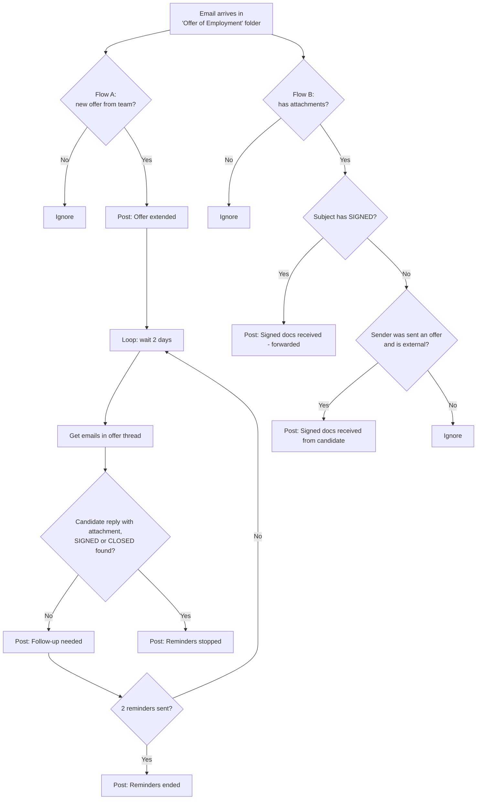

<p align="center"></p>

<h1 align="center">Attachment Radar</h1>

**Automated Teams alerts and follow-up reminders for signed offer documents, built with Power Automate.**

Attachment Radar watches the team's offer emails in Outlook, announces each new offer in a Microsoft Teams group chat, sends up to two follow-up reminders, 2 days apart, if the candidate's signed documents haven't come back, and posts the moment they arrive.

> Built for a four-person HR recruiting team (ANZ region) that sends offer documents to candidates through Oracle Recruiting Cloud and email, and needs every signed document back.

---

## The problem

After extending an offer, the team emails the offer documents to the candidate, with a shared distribution list (distro) in CC. Candidates must return **signed** documents by email.

Before this project:

- Nobody was told when an offer went out, so status lived in people's heads.
- Following up on unreturned documents was manual. Offers could sit unsigned without anyone noticing.
- An earlier notification flow posted **every** email in the folder to one person's chat, which was noisy and invisible to the rest of the team.

**Constraint:** no new list or database of candidate emails could be created. Storing candidate data would have triggered an extra data-retention review.

## The solution

Two Power Automate cloud flows that use the **mailbox itself as the source of truth**. No candidate data is stored outside Outlook.

| Event | Flow | Teams group chat message |
|---|---|---|
| A team member emails an offer to a candidate (distro in CC) | Flow A | **Offer extended**: candidate, offer, sender, time |
| 2 days pass with no signed documents | Flow A | **Follow-up needed (reminder 1 of 2)** |
| 4 days pass with no signed documents | Flow A | **Follow-up needed (reminder 2 of 2)** |
| Candidate replies with attachments | Flow B | **Signed documents received from candidate** (within minutes) |
| Teammate forwards signed docs with `[SIGNED]` in the subject | Flow B | **Signed documents received (forwarded)** |
| Signed docs, `[SIGNED]` or `[CLOSED]` found at a check | Flow A | **Reminders stopped** |
| Still nothing after reminder 2 | Flow A | **No more automatic reminders**: follow up manually |



## How it works

### Flow A – Offer extended and reminders
1. **Trigger:** *When a new email arrives (V3)* on the *Offer of Employment* folder, subject contains "Offer of Employment".
2. **Variables** capture the candidate (first **To** address), offer subject, sender and sent time.
3. **Is new offer:** continues only for an email from a company domain that isn't a reply (`RE:`), a forward (`FW:`) or a `[SIGNED]`/`[CLOSED]` email.
4. Posts **Offer extended** to the team's Teams group chat.
5. **Do until** loop (max 2 rounds, timeout `P29D`):
   - **Delay** 2 days
   - **Get emails (V3):** all emails whose subject contains this offer's subject
   - **Filter array:** keeps emails received after the offer that are `[SIGNED]`, `[CLOSED]`, or from the candidate with attachments
   - If something is found → set `varDone = true` (loop ends); otherwise post **Follow-up needed (reminder n of 2)**.
6. After the loop, posts **Reminders stopped** (with what was found) or **No more automatic reminders**.

### Flow B – Signed documents received
1. **Trigger:** same folder, subject contains "Offer of Employment", **only with attachments**.
2. If the subject contains `[SIGNED]` → posts **forwarded** message.
3. Otherwise **Get emails (V3)** looks for an offer previously sent **to** this sender. If one exists and the sender is external → posts **received from candidate**.

Full step-by-step instructions: [`docs/build-guide.md`](docs/build-guide.md) · All expressions: [`docs/expressions.md`](docs/expressions.md)

## Key design decisions

- **Mailbox as state, no candidate list.** Each offer's Flow A run holds its own state in variables while it waits. Replies are matched by subject, so no candidate data is copied into SharePoint, Excel or Dataverse. This met the "no new data store" constraint.
- **One run per offer.** Every offer email starts its own run with its own 2-day timer, so offers sent on different days are tracked independently.
- **Capped reminders, inside platform limits.** The team wanted at most two nudges per candidate, so the loop runs 2 rounds × 2 days, then hands over to a person with a "follow up manually" message. A single cloud flow run can't exceed 30 days, so the design keeps Count × Delay well under that (the first version allowed 13 reminders over 26 days).
- **Human override built in.** Candidates sometimes reply only to the sender, which the flow can't see. A simple team convention covers this: forward to the distro with `[SIGNED]`, or send `[CLOSED]` when an offer is declined.
- **Two flows, two speeds.** Flow A checks every 2 days; Flow B reacts within minutes, so the team hears about returned documents straight away.
- **Noise filtering.** Domain checks and subject rules keep internal chatter, replies and forwards from triggering false alerts.

## Challenges and fixes

| Problem | Cause | Fix |
|---|---|---|
| `convertFromUtc` failed on Outlook timestamps | Outlook returns `…+00:00`; `convertFromUtc` expects `…Z` | Used `addHours(time, 8, format)`. Manila is fixed UTC+8 with no daylight saving |
| Filter array save error: *"'where' must be a template language expression"* | A leading space before `@` made the filter plain text | Pasted the expression as a single line starting with `@` |
| Power Automate silently added a **For each** loop | A dynamic-content chip came from *Get emails* (an array) instead of the trigger | Replaced the chips with explicit `triggerOutputs()?['body/…']` expressions |
| Reminders didn't stop even though the candidate had replied | *Get emails* had **Fetch Only Unread = Yes**, so the reply was skipped once someone opened it | Set it to **No**, raised **Top** to 50, and matched the sender with `contains` |
| A save failed with "This expression has a problem" | The `@` prefix was pasted into the **fx** editor, which doesn't accept it | Use `@` only when typing straight into an advanced-mode box; leave it out in the fx editor |
| Delay ended up after the loop instead of inside it | The new designer shows a Do until's condition bar at the bottom of the box | Moved the Delay between the **Do** label and the loop's condition bar |
| Do until would have stopped after 1 hour | Default timeout is `PT1H` | Set Timeout to `P29D` and Count to `2` |

## Testing

Tested end to end with a personal address standing in for the candidate and the Delay temporarily set to 3 minutes:

- ✅ Offer email → **Offer extended** posted with correct Manila time
- ✅ No reply → **Follow-up needed** posted at each check
- ✅ Candidate *Reply All* with PDF → **Reminders stopped** (matched the `Re:` reply)
- ✅ Candidate reply → Flow B **Signed documents received from candidate**
- ✅ `[SIGNED]` forward → Flow B **forwarded** message

## Tech stack

Power Automate (cloud flows, new designer) · Office 365 Outlook connector · Microsoft Teams connector · Workflow Definition Language expressions

## Skills demonstrated

Process analysis and requirements gathering · Workflow automation design · Privacy-by-design (no extra data store) · Power Automate expressions (string, date/time, array filtering, logical) · Loop and state handling within platform limits · Debugging failed flow runs · End-to-end testing · Writing team process conventions and documentation

## Limitations and future ideas

- Reminders post on weekends too. A weekday check could skip Saturday and Sunday.
- Matching relies on a consistent subject line (`… Offer of Employment for [Candidate Name]`).
- A brand-new email re-sending an offer with the same subject starts a second reminder run; re-sends should be replies.
- Possible next steps: an adaptive card with a **Mark as signed** button, a weekly summary of open offers, or Oracle Recruiting Cloud status integration.

## AI disclosure

This project was designed, built and tested by me in my organisation's Power Automate environment. I used **Claude (Anthropic)** as an AI assistant to:

- talk through the solution design, including the no-extra-data-store approach and working within the 30-day run limit
- draft Power Automate expressions and step-by-step build instructions
- debug failed runs (time-zone conversion, filter syntax, an unexpected For each loop)
- draft this documentation and the project icon

I configured every flow myself, ran the end-to-end tests, and reviewed and edited all of the content here.

## Repository contents

```
README.md               Project overview (this file)
assets/                 Project icon (PNG + SVG)
docs/build-guide.md     Step-by-step build instructions for both flows
docs/expressions.md     Every expression used, with explanations
screenshots/            (add your own redacted screenshots here)
```

---

*Company names, email addresses, domains and candidate details have been removed or replaced with placeholders.*
